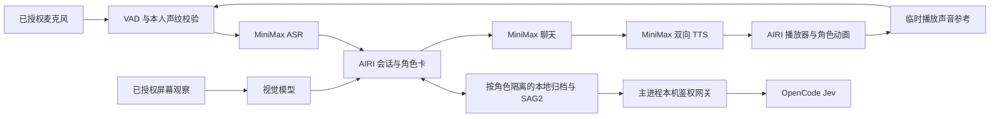
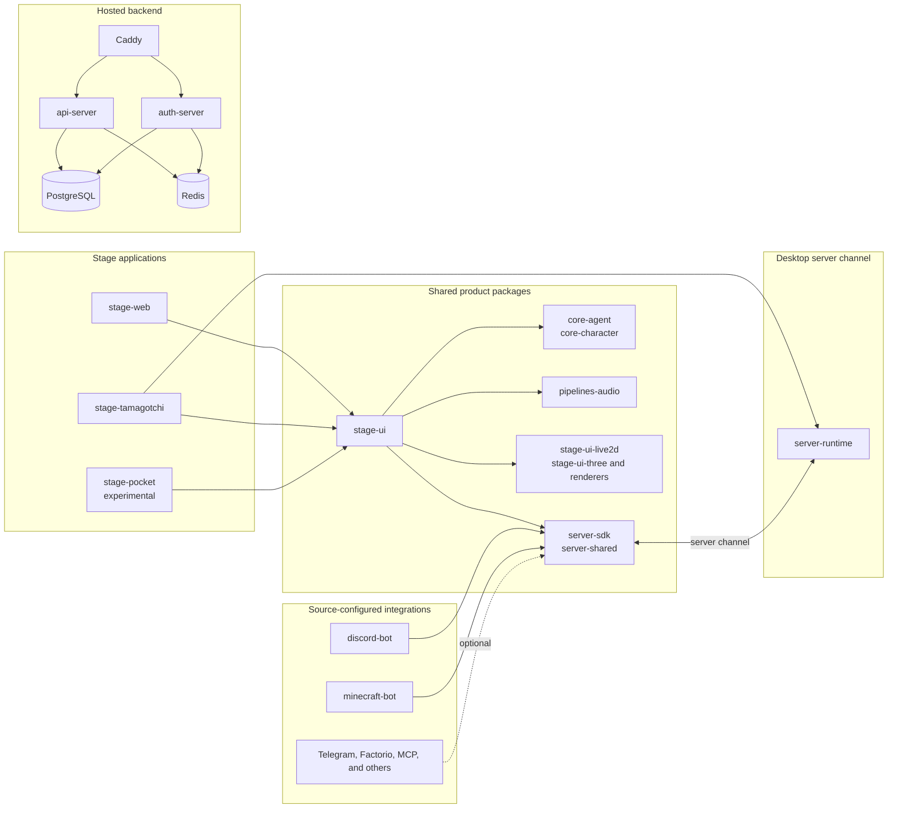

# AIRI — A6y55 Fork

本仓库是 [moeru-ai/airi](https://github.com/moeru-ai/airi) 的 Fork，仓库地址为 **[A6y55/airi](https://github.com/A6y55/airi)**。
目标是在 AIRI 现有桌面应用上集成长期记忆、稳定角色身份、自然语音交互和经用户授权的屏幕观察。
复用 AIRI 的渲染、角色卡、提供方、会话和音频管线，仅补充组件缺失的适配与修复。

以下是本 Fork 的开发记录和运行配置，更新于 **2026-11-08**。配置来自当前运行实例及实际代码，不代表所有新安装的默认值。
本机目录和启动器沿用 `airi-companion` 名称；项目仍是 AIRI Fork，没有另建桌宠框架。
当前本地改动以源码和验证记录为准，未声明已有包含这些改动的 Fork 安装包。

- [接口与当前配置](#fork-configuration)
- [组件与数据流](#fork-architecture)
- [构建、启动与数据位置](#fork-setup)
- [开发记录](#fork-development-log)
- [验证结果与已知限制](#fork-validation)
- [上游项目介绍](#upstream-project)

<a id="fork-configuration"></a>

## 接口与当前配置

### 当前使用的服务

| 用途 | 提供方 ID / 组件 | 当前模型 | 地址与协议 |
| --- | --- | --- | --- |
| 对话 | `minimax` | `MiniMax-M3.1-Flash` | Base URL `https://api.minimax.cn/v1/`，OpenAI 兼容聊天接口 `/chat/completions` |
| 视觉识别 | `vision-minimax`，定义为 `minimax` | `MiniMax-M3.1-Flash` | Base URL `https://api.minimaxi.com/v1/`，独立视觉模块处理聊天图片、工具图片和已授权屏幕帧 |
| 语音识别 | `minimax-audio-transcription` | `asr-1.0` | Base URL `https://api.minimax.cn/v1/`，上传音频到 `/speech_to_text` |
| 桌面语音合成 | `minimax-speech` | `speech-2.8-turbo` | `wss://api.minimax.cn/ws/v1/t2a_v2_bidi`，双向流式 WebSocket |
| 声线预览 / HTTP 合成 | `minimax-speech` | `speech-2.8-turbo` | `POST https://api.minimax.cn/v1/t2a_v2` |
| 账号声线目录 | `minimax-speech` | 系统、克隆和生成声线 | `POST https://api.minimax.cn/v1/get_voice` |
| 记忆检索决策 | OpenCode Jev，经本机网关转发 | `jev-1.13-free` | `https://opencode.ai/inference/systemone/v1/systemone` |
| 本地记忆服务 | [SAG2 / SAG-Wiki](https://github.com/Zleap-AI/SAG-Wiki) CLI | 已安装 `sag 0.2.7` | 默认可执行文件 `~/.local/bin/sag`，AIRI 主进程负责启动与管理 |
| 本地声纹识别 | Sherpaw / CAM++ | `sherpaw-campplus-zh-en-advanced` | 本地 Worker 推理，不调用云端声纹 API |

MiniMax 的 API Key 在应用的提供方设置中填写，同一账号的 Key 可分别配置到聊天、视觉、ASR 和 TTS 提供方。
README 不保存 Key、Authorization 值、运行时网关令牌、声纹向量或个人聊天原文。
Jev 的上述精确免费地址与模型组合在已验证配置中无需 Key；免费服务是限时安排，其他 Jev 地址仍要求凭据。
本地归档不等于本地推理：启用云端接口时，对应消息、音频、已授权图片或检索判断所需文本会发往相应提供方。

角色卡可以覆盖全局模块选择。当前 `default` 卡的名称和昵称为“珊璞”，其聊天、视觉和语音选择与上表一致。
**实际声线为 `Japanese_GracefulMaiden`**。提供方配置中仍保存 `female-shaonv`，但当前输出使用角色卡的 `voice_id`。
这些是本机配置示例，不是 Fork 强制写入每个用户的角色设定。

### 当前行为开关

| 项目 | 当前实例 | 行为 |
| --- | --- | --- |
| 思考开关 | 关闭 | 对 M3.1-Flash 映射为 `reasoning_effort=low`，不是关闭模型内部思考 |
| Temperature | 开关关闭，保存值 `1.4` | 请求不发送该采样参数 |
| Top-p | 开关关闭，保存值 `1` | 请求不发送该采样参数 |
| 麦克风 / Hearing | 已启用，`always-on` | 当前用户已授权持续监听，新配置默认不打开采集 |
| 自动发送 | 已启用 | 识别完成后自动提交输入 |
| 语音改写 | 关闭 | `rephraseProvider`、`rephraseModel` 均为空；启用且未另选模型时使用聊天模型 |
| 停顿结束判断模型 | 关闭 | 当前按 1.2 秒停顿规则收尾，不额外调用结束判断模型 |
| 声纹识别 | 已启用 | 使用已登记的本人声纹；播放期间另与实际输出声音比较 |
| TTS | 已启用 | 使用上表模型与角色卡声线 |
| Vision | 已启用 | `useForChat=true`、`useForToolImages=true` |
| 屏幕观察启动 | 已启用 | 启动独立观察窗口及来源选择流程，仍须系统授权与来源确认 |
| 屏幕上下文发布 | 已启用 | 工作负载 `screen:interpret`，缩放 `100%`，最新现场间隔 `14250 ms` |
| 长期记忆 | 已启用 | 按角色独立归档并使用 SAG2 检索 |
| 桌面操作权限 | 每次请求由用户选择 | “Use computer”默认关闭，历史请求不授予新请求权限 |

开启屏幕观察后，定时视觉识别会产生请求。它与空闲时不主动发起聊天或记忆检索的规则分开。
当前关闭的语音改写、结束判断模型，与代码中新配置的默认开关不是同一概念。

### 已保存但未选用的提供方

| 提供方 ID | 已保存地址 / 模型 | 当前状态 |
| --- | --- | --- |
| `openai-compatible` | `https://loliapi.org` | 已配置，但当前角色的聊天和视觉都未选择它；本次未验证其连通性 |
| `openai-compatible-audio-transcription` | `https://api.minimax.cn/v1/speech_to_text/`，`asr-1.0` | 保留的旧配置；当前使用专用 `minimax-audio-transcription`，新配置请使用上表 Base URL |
| `browser-web-speech-api` | 无服务地址 | 未配置、未启用 |

提供方显示“已配置”只表示保存了配置，不代表本次做过连接测试。

### 接口行为与存储

- ASR 是文件上传接口。`stream=true` 表示上传后的文字流式返回，不是边录音边上传的实时音频会话。
- 桌面 TTS 每个语音流使用一条 WebSocket。增量文字交给 MiniMax 分句，32 kHz 单声道 PCM 到达后立即进入现有播放器。
- 文本结束发送 `task_finish`，等待 `task_finished`。`is_final` 不等于整条会话结束。
- 打断、取消和窗口退出关闭 TTS 连接并丢弃迟到音频。主进程读取凭据，通过 Authorization 头发送。
- TTS 主进程仅允许代码列出的官方 HTTPS 域名，不接受渲染进程传入任意上游地址或 Key。这里未使用旧 `/ws/v1/realtime` 接口。
- Jev 经 `http://127.0.0.1:<动态端口>/jev/v1/systemone` 转发。端口和鉴权令牌由主进程生成，不应硬编码。
- 提供方凭据持久化使用 Electron `safeStorage` 和系统钥匙串。钥匙串不可用或仅提供明文后端时显式报错。
- 首次迁移先完成加密写入，再移除旧凭据存储；之后由 Pinia 选举出的配置所有者串行保存。

官方接口参考：[MiniMax 聊天与思考](https://platform.minimax.cn/docs/api-reference/text-chat-openai)、[ASR](https://platform.minimax.cn/docs/api-reference/speech-to-text)、[双向 TTS](https://platform.minimax.cn/docs/api-reference/speech-t2a-websocket-bidi)、[系统声线](https://platform.minimax.cn/docs/faq/system-voice-id)、[OpenCode Jev](https://opencode.ai/docs/console/models/#jev)。

<a id="fork-architecture"></a>

## 组件与数据流



桌面宿主为 `apps/stage-tamagotchi`，共享角色、语音和视觉逻辑在 `packages/stage-ui`。
组件间复用 Eventa IPC，声纹复用 Sherpaw，动画复用 AIRI 现有模型驱动。
SAG2 指 **Zleap-AI/SAG-Wiki**，当前通过其 CLI 集成。没有并行部署 Mem0、Letta 或 Graphiti，也没有自建向量数据库。

记忆保存用户原文、最终角色回复、时间和来源标识，不保存模型推理过程。每个角色独立归档、检索、编辑、删除和导出。
召回附带证据日期与说话人标签，总注入上限为 12,000 字符。SAG 返回候选证据，角色仍须判断相关性。
检索失败时保留本地记录和桌宠渲染，并明确限制模型只能依据当前对话。
当前实现是证据归档和检索适配，不能据此声称已实现全部自动事实抽取、冲突合并和偏好纠错要求。

主要实现入口：

| 边界 | 文件 |
| --- | --- |
| 伙伴初始化、归档与召回挂钩 | [renderer/stores/companion.ts](apps/stage-tamagotchi/src/renderer/stores/companion.ts) |
| 伙伴 IPC 与设置生命周期 | [main/services/airi/companion.ts](apps/stage-tamagotchi/src/main/services/airi/companion.ts) |
| 凭据加密与 Jev 本机网关 | [companion-gateway.ts](apps/stage-tamagotchi/src/main/services/airi/companion-gateway.ts) |
| SAG CLI 适配 | [sag-memory.ts](apps/stage-tamagotchi/src/main/services/airi/sag-memory.ts) |
| 桌面 MiniMax 双向 TTS | [minimax-speech.ts](apps/stage-tamagotchi/src/main/services/airi/minimax-speech.ts) |
| 语音输入、回复与打断 | [voice.ts](packages/stage-ui/src/stores/voice.ts) |
| 本人声纹与播放参考 | [speaker-tracker.ts](packages/stage-ui/src/stores/speaker-tracker.ts)、[owner-speech.ts](packages/stage-ui/src/libs/voice/owner-speech.ts) |
| 视觉上下文发布 | [vision/orchestrator.ts](packages/stage-ui/src/stores/modules/vision/orchestrator.ts) |

<a id="fork-setup"></a>

## 构建、启动与数据位置

版本文件记录 Node.js `26.12.1`、pnpm `11.24.0`。桌面包版本为 `0.14.1`，本次现场验证环境为 Linux / XWayland。
上游支持的平台范围不等于本 Fork 已逐个平台验收；Windows、macOS 和移动端未在这次验证中重测。

```sh
git clone https://github.com/A6y55/airi.git
cd airi
git remote add upstream https://github.com/moeru-ai/airi.git
pnpm install
pnpm -F @proj-airi/stage-tamagotchi build
```

开发模式从仓库根目录运行 `pnpm dev:tamagotchi`。Linux XWayland 可使用 `pnpm dev:tamagotchi:xwayland`。
按 [SAG-Wiki 安装说明](https://github.com/Zleap-AI/SAG-Wiki) 安装 `sag`，并在“设置 → 本地伙伴”配置实际二进制路径。
默认路径为 `~/.local/bin/sag`。首次初始化也可用 `AIRI_SAG_BINARY` 指定路径；已保存的伙伴设置优先。
SAG CLI 是外部组件，不由 `pnpm install` 自动安装。

Linux 上以独立用户数据目录运行已构建版本：

```sh
APP_USER_DATA_PATH="$HOME/.local/share/airi-companion" \
NODE_USE_ENV_PROXY=1 \
pnpm -F @proj-airi/stage-tamagotchi exec electron --ozone-platform=x11 .
```

当前机器另有 `~/.local/bin/airi-companion` 启动器，指向本地 `~/code/airi-companion` 检出目录。
该启动器是本机安装配置，不随 Git 克隆自动创建。其他平台可使用 `pnpm -F @proj-airi/stage-tamagotchi start`，无需 X11 参数。
更改主进程 IPC 或 TTS 传输后必须重启应用，仅刷新渲染窗口不足以加载这些变化。

| 数据 | 当前独立配置目录下的位置 |
| --- | --- |
| AIRI 设置与会话 | `<userData>` 下现有 Electron / AIRI 存储 |
| 伙伴设置 | `<userData>/companion/settings.json` |
| 加密提供方凭据 | `<userData>/companion/companion-vault/keys.enc` |
| 按角色隔离的记忆原文 | `<userData>/companion/memories` |
| SAG 工作数据 | `<userData>/companion/sag` |
| 运行日志与 IO 追踪 | `<userData>/logs`、`<userData>/io-traces` |

这些目录不是 Fork 的源码或发布资源。麦克风、屏幕和桌面操作需要用户主动授权。
开发时使用 `origin` 指向 `A6y55/airi`，`upstream` 指向 `moeru-ai/airi`；不要把上游仓库作为本 Fork 的推送目标。

<a id="fork-development-log"></a>

## 开发记录

以下记录汇总截至 2026-11-08 的已实施改动。历史验证是对应修改时的观察，不冒充本次重新执行的检查。

### 配置保存与角色身份

- 曾出现窗口显示默认 ReLU、但磁盘仍保留原角色配置的情况。已恢复 46 项配置，并通过正常退出、冷启动检查角色、声线、声纹和思考偏好。
- 一次退出被诊断连接拖延；先断开诊断连接、确认旧进程退出，再启动新实例。它与全部配置丢失现象的因果关系尚未完全证明。
- 修复伙伴初始化每次启动都重置思考和采样开关的问题。默认值仅在首次配置时应用。
- 当前角色卡名称和昵称作为明确身份进入上下文。保留原描述、性格和场景，软件或工具标签不再充当角色名字。

### 记忆清理边界

- 清空角色记忆时，先停止该角色旧会话的回复，清空其 SAG 归档与索引，再创建并选中新会话。
- 旧聊天留在历史列表中，不进入新会话上下文。此前仅清空长期记忆后，156 条旧会话消息仍可能重新影响角色。
- 清空记忆保留角色卡、提供方凭据、模型、声线和声纹；删除单条文档不重置会话。修改角色卡也不会自动抹除记忆。
- 实际界面和 SAG 生命周期测试覆盖了清空、编辑、删除、重放和重启隔离。

### 上下文膨胀与录音收尾

- 打断记录曾复制完整轮次快照及截图，导致提示膨胀到约 154 万字符并触发 MiniMax `context window exceeds limit (2013)`。
- 现在只传递会话、轮次标识、原因和播放进度。一次复测的系统提示降至 19,637 字符，回复与播放恢复。
- 曾有自动输入停留在 `capturing` 约 901 秒。现在首次本人匹配后，按已验证本人活动累计非本人窗口时长并收尾。
- 背景 VAD 活动不能无限延长已确认本人的录音。计时使用音频帧，手动输入、取消和新输入互相隔离。
- 首次匹配前保留最多三秒首段并复验完整区间，通过后才补给转写；这不是固定等待三秒。

### 连续插话与语音失败恢复

- 最新两份真实追踪显示，前一条已识别输入仍在等待记忆检索时，就被登记为可打断回复；下一句插话导致它在保存前取消，并报 `Chat request ended before persistence`。
- Stage 现在在用户消息真实持久化后的 `onBeforeSend` 才打开语音回复。准备期间的新输入继续识别并按现有队列提交，保留原来的异步上下文和回复目标校验。
- 迟到的本人声纹结果只打断输入开始时捕获的旧轮次。后来启动的回复不会因此被取消，当前用户输入也不会被丢弃。
- 回复边界显式只传 `sessionId`、`turnId`，不把整个聊天上下文暴露为语音轮次。
- ASR 错误后的 PCM 清理曾先产生“取消”，覆盖真实转录错误。现在由转录输出决定其结果；显式用户取消及采集失败仍立即生效。
- 真实 MiniMax 桌面验收中，准备期间连续提交两条输入，两条均保存并完成回复，发送前持久化检查通过。验收使用临时隐藏会话，原活动会话未切换，结束后已清理。
- MiniMax 的 `429 / conn limit (1041)` 仍是独立服务限额错误。这次保证错误正确上报及后续输入可恢复，不宣称已消除提供方限额。


### TTS 与播放声音误打断

- 一次长回复在约 2.45 秒内触发 21 次 HTTP 合成请求并被限流。桌面回复已切换为官方双向 WebSocket，每个语音流一条连接。
- 真实 IO 追踪还记录了播放约 19 秒后的 `speech-input` 中止。原门控只比较本人声纹，缺少输出声音对照。
- 当前从实际音频播放节点取得 PCM，复用 CAM++ Worker 生成临时播放参考；输入必须同时满足本人阈值和比播放参考更接近本人。
- 播放参考使用最多 1.5 秒输出 PCM，仅驻留内存。首个参考未形成时不放行自动打断；短回复结束后恢复后续输入。
- 本人自动打断仍使用半秒比较窗口。模型登记与比较请求按序发送，但已取消输入的迟到结果不阻塞新输入。
- 声纹缺失、变化、模型失败或取消均不能把未经检查的音频交给转写。Stop 和 Push to Talk 保留显式手动控制。

### 屏幕观察与桌面交互

- 屏幕观察独立于普通设置页，设置导航不再停止采集。观察窗口可最小化；关闭窗口、禁用 Vision 或点击停止会结束共享。
- 启动偏好、上下文发布、工作负载、缩放和间隔持久化；不保存旧来源 ID，不绕过系统权限。
- Linux PipeWire 的整个桌面可能列在 Applications 下。来源确认后再恢复观察，预览画面本身不代表已发布上下文。
- 修复系统已选源后仍卡在第二次“Share Window”的问题：开启启动恢复时，唯一且带 Chromium 原生选择器 `:s` 会话标记的本次来源自动接续首帧和 ticker。
- 普通单项列表、多个来源、系统拒绝及取消都不会自动选第一项；停止或关闭后，晚到的目录及识别结果不能恢复采集或发布。
- 新构建实际重启后无需二次点击即可获得 2560×1440 画面，主聊天收到当前屏幕描述，多次发布成功且失败计数为 0。
- 一次真机检查取得 2560×1440 屏幕流，设置导航后仍继续采集，识别与上下文发布两次成功、零失败。
- Linux 可用四向箭头拖动角色。Wayland / XWayland 下可见角色与聊天区域保留交互，透明像素显示桌面但不穿透点击。

<a id="fork-validation"></a>

## 验证结果与已知限制

| 验证 | 已记录结果 |
| --- | --- |
| 最新共享语音链路回归 | 5 个文件，56 项通过 |
| 语音核心取消与错误优先级 | 1 个文件，20 项通过 |
| 桌面连续输入、屏幕恢复与来源隔离 | 4 个文件，50 项通过；三组共 126 项 |
| 根级类型检查 | 65 个任务通过 |
| 根级 lint | 零错误，676 条已有警告 |
| 桌面构建 | 通过 |
| 真实连续输入 | 两条输入均持久化并完成真实模型回复，原会话未切换，临时会话已清理 |
| 真实屏幕自动恢复 | 系统选源后自动出现 2560×1440 首帧，主聊天收到屏幕上下文，无需二次点源 |
| 真实当前声线播放 | 约 10.45 秒，返回 `finished`，活动轮次归零 |
| 真实 CAM++ 检查合成音频 | 拒绝 9.42 秒音频；18 个半秒窗口的本人相似度最高约 0.163，播放参考相似度约 0.380–0.665 |
| 历史双向 TTS 首批 PCM | 一次实测约 587 ms，文字输入尚未结束 |
| 历史简短聊天请求 | 一次实测约 1,528 ms 首字、1,707 ms 首声；不包含 ASR、停顿判断和记忆检索耗时 |
| 历史其他回归 | 自动录音与身份 74 项；句首缓存、打断与视觉取消 38 项；视觉窗口与启动生命周期 26 项 |

现场麦克风回录混有其他讲话，直接复验存在被接纳区间，**不能将其称为纯回声排除验证**。
本次没有新的独立标注本人讲话样本；半秒本人打断由控制器回归覆盖，不代表现场识别准确率已验收。
短音频、相似音色和多人混说仍可能误判。SAG 候选证据也可能不相关，不能据此编造共同经历。
当前已验证本地记忆持久化和生命周期，不宣称原始目标中的每项长期记忆及自然人格验收都已完成。

复现相关检查时，从仓库根目录执行：

```sh
pnpm -F @proj-airi/core-agent build
pnpm -F @proj-airi/core-agent exec vitest run src/voice/controller.test.ts
pnpm -F @proj-airi/stage-ui exec vitest run src/stores/speaker-tracker.browser.test.ts src/libs/voice/owner-speech.test.ts src/libs/voice/speaker-tracker.test.ts src/stores/voice-interruption.browser.test.ts src/stores/voice-owner-endpoint.browser.test.ts
pnpm -F @proj-airi/provider-inference exec vitest run src/providers/cloud/minimax/index.test.ts src/providers/cloud/minimax-speech/stream.test.ts
pnpm -F @proj-airi/stage-ui exec vitest run src/libs/speech/minimax-speech.test.ts src/libs/voice/voice-activity-plugin.test.ts src/stores/modules/vision/orchestrator.test.ts src/stores/modules/airi-card.test.ts
pnpm -F @proj-airi/stage-tamagotchi exec vitest run src/renderer/pages/devtools/vision.browser.test.ts src/renderer/app.browser.test.ts src/renderer/stores/companion.browser.test.ts src/main/services/airi/minimax-speech.test.ts
pnpm -F @proj-airi/stage-tamagotchi exec vitest run src/renderer/components/stage-voice-interruption.browser.test.ts src/renderer/pages/devtools/vision.browser.test.ts src/renderer/app.browser.test.ts src/main/services/electron/screen-capture.test.ts
AIRI_SAG_BINARY="$HOME/.local/bin/sag" pnpm -F @proj-airi/stage-tamagotchi exec vitest run src/main/services/airi/sag-memory.test.ts
pnpm typecheck --concurrency=2
pnpm lint
pnpm -F @proj-airi/stage-tamagotchi build
```

`core-agent` 的公开入口指向 `dist`。修改其源码后先构建该包，再运行桌面或浏览器回归，避免误测旧产物。

声纹模型固定到 [moeru-ai/sherpaw-campplus-zh-en-advanced](https://huggingface.co/moeru-ai/sherpaw-campplus-zh-en-advanced) 的 `5fc23543ac94200ae77514cf1c40596c5d70f6e8` 修订。
应用细节另见 [桌面工程 README](apps/stage-tamagotchi/README.md) 和 [共享界面 README](packages/stage-ui/README.md)。后续开发记录统一更新本 README。

<a id="upstream-project"></a>

## 上游项目介绍

下方保留 AIRI 上游的介绍、资源、社区和下载入口。上游下载及演示不包含本 Fork 尚未发布的改动。
Fork 保留上游 [MIT 许可证](LICENSE) 与署名；角色模型、素材和第三方组件分别遵循各自许可证。

<picture>
  <source
    width="100%"
    srcset="./docs/assets/banner-dark-1280x640.avif"
    media="(prefers-color-scheme: dark)"
  />
  <source
    width="100%"
    srcset="./docs/assets/banner-light-1280x640.avif"
    media="(prefers-color-scheme: light), (prefers-color-scheme: no-preference)"
  />
  
</picture>

<h2 align="center">Project AIRI — Upstream</h2>

<p align="center">Re-creating Neuro-sama, a soul container of AI waifu / virtual characters to bring them into our world.</p>

<p align="center">
  [<a href="https://discord.gg/TgQ3Cu2F7A">Join Discord Server</a>] [<a href="https://airi.moeru.ai">Try it</a>] [<a href="https://github.com/moeru-ai/airi/blob/main/docs/README.zh-CN.md">简体中文</a>] [<a href="https://github.com/moeru-ai/airi/blob/main/docs/README.ja-JP.md">日本語</a>] [<a href="https://github.com/moeru-ai/airi/blob/main/docs/README.ru-RU.md">Русский</a>] [<a href="https://github.com/moeru-ai/airi/blob/main/docs/README.vi.md">Tiếng Việt</a>] [<a href="https://github.com/moeru-ai/airi/blob/main/docs/README.fr.md">Français</a>] [<a href="https://github.com/moeru-ai/airi/blob/main/docs/README.ko-KR.md">한국어</a>]
</p>

<p align="center">
  <a href="https://deepwiki.com/moeru-ai/airi"></a>
  <a href="https://github.com/moeru-ai/airi/blob/main/LICENSE"></a>
  <a href="https://discord.gg/TgQ3Cu2F7A"></a>
  <a href="https://x.com/proj_airi"></a>
  <a href="https://t.me/+7M_ZKO3zUHFlOThh"></a>
  <a href="./docs/wechat.md"></a>
  <a href="https://qun.qq.com/universal-share/share?ac=1&authKey=9g00d%2BZS7nORzcJugNNddJ7rCghZTIR7fhXabGwch2S%2BG%2BKGIKwlN1N2nIqkh2jg&busi_data=eyJncm91cENvZGUiOiIxMDU4MTU2Njk3IiwidG9rZW4iOiJmcnkra1hWNFIxNytEcG0zcHRUdVJIaldlRDFxN0dzK080QWtvTEdOQjJkNEY2eUFta1g1clNpbkxSMS9FQWFYIiwidWluIjoiMTI2MDkwNzMzNSJ9&data=b1eJrwn3GVOUh7YIxZ7l9vHQo99HPmRxKPpMKlDCmfzx8Y57IXb2EZCMaOC9rVTd2U558qpNjwUYUWlPHxVHvg&svctype=4&tempid=h5_group_info"></a>
</p>

<p float="left" align="center">
  <!-- readme-section:release-binary-windows -->
  <a href="https://github.com/moeru-ai/airi/releases/download/v0.14.0/AIRI-0.14.0-windows-x64-setup.exe">
    <picture>
      <source
        width="33%"
        srcset="./docs/assets/download-buttons/download-buttons.windows.dark.en-US.avif"
        media="(prefers-color-scheme: dark)"
      />
      <source
        width="33%"
        srcset="./docs/assets/download-buttons/download-buttons.windows.light.en-US.avif"
        media="(prefers-color-scheme: light), (prefers-color-scheme: no-preference)"
      />
      
    </picture>
  </a>
  <!-- readme-section:release-binary-macos -->
  <a href="https://github.com/moeru-ai/airi/releases/download/v0.14.0/AIRI-0.14.0-darwin-arm64.dmg">
    <picture>
      <source
        width="33%"
        srcset="./docs/assets/download-buttons/download-buttons.macos.dark.en-US.avif"
        media="(prefers-color-scheme: dark)"
      />
      <source
        width="33%"
        srcset="./docs/assets/download-buttons/download-buttons.macos.light.en-US.avif"
        media="(prefers-color-scheme: light), (prefers-color-scheme: no-preference)"
      />
      
    </picture>
  </a>
  <a href="https://github.com/moeru-ai/airi/releases/latest">
    <picture>
      <source
        width="33%"
        srcset="./docs/assets/download-buttons/download-buttons.linux.dark.en-US.avif"
        media="(prefers-color-scheme: dark)"
      />
      <source
        width="33%"
        srcset="./docs/assets/download-buttons/download-buttons.linux.light.en-US.avif"
        media="(prefers-color-scheme: light), (prefers-color-scheme: no-preference)"
      />
      
    </picture>
  </a>
</p>

<p float="left" align="center">
  <a href="https://airi.moeru.ai">
    <picture>
      <source
        width="33%"
        srcset="./docs/assets/QR%20code%20button/section.cards.qrcode.dark.en-US.avif"
        media="(prefers-color-scheme: dark)"
      />
      <source
        width="33%"
        srcset="./docs/assets/QR%20code%20button/section.cards.qrcode.light.en-US.avif"
        media="(prefers-color-scheme: light), (prefers-color-scheme: no-preference)"
      />
      
    </picture>
  </a>
  <a href="https://airi.moeru.ai">
    <picture>
      <source
        width="33%"
        srcset="./docs/assets/download-buttons/download-buttons.mobile.dark.en-US.avif"
        media="(prefers-color-scheme: dark)"
      />
      <source
        width="33%"
        srcset="./docs/assets/download-buttons/download-buttons.mobile.light.en-US.avif"
        media="(prefers-color-scheme: light), (prefers-color-scheme: no-preference)"
      />
      
    </picture>
  </a>
  <a href="https://airi.moeru.ai">
    <picture>
      <source
        width="33%"
        srcset="./docs/assets/download-buttons/download-buttons.browser.dark.en-US.avif"
        media="(prefers-color-scheme: dark)"
      />
      <source
        width="33%"
        srcset="./docs/assets/download-buttons/download-buttons.browser.light.en-US.avif"
        media="(prefers-color-scheme: light), (prefers-color-scheme: no-preference)"
      />
      
    </picture>
  </a>
</p>

<p align="center">
  <a href="https://www.producthunt.com/products/airi?embed=true&utm_source=badge-featured&utm_medium=badge&utm_source=badge-airi" target="_blank"></a>
  <a href="https://trendshift.io/repositories/14636" target="_blank"></a>
  <a href="https://trendshift.io/repositories/14636" target="_blank"></a>
</p>

> Heavily inspired by [Neuro-sama](https://www.youtube.com/@Neurosama)

> [!TIP]
> On Windows, you can also install AIRI with [winget](https://learn.microsoft.com/windows/package-manager/winget/):
>
> ```powershell
> winget install MoeruAI.AIRI
> ```
>
> Or install AIRI with [Scoop](https://scoop.sh/):
>
> ```powershell
> scoop bucket add airi https://github.com/moeru-ai/airi
> scoop install airi/airi
> ```
>
> On macOS, you can install AIRI with [Homebrew Cask](https://brew.sh/) without adding a custom tap:
>
> ```sh
> brew install --cask airi
> ```

> [!WARNING]
> **Attention:** We **do not** have any officially minted cryptocurrency or token associated with this project. Please check the information and proceed with caution.

> [!NOTE]
>
> We've got a whole dedicated organization [@proj-airi](https://github.com/proj-airi) for all the sub-projects born from Project AIRI. Check it out!
>
> RAG, memory system, embedded database, icons, Live2D utilities, and more!

> [!TIP]
> You can translate AIRI on [Crowdin](https://crowdin.com/project/proj-airi), or open a pull request that changes `packages/i18n/src/locales/`. Both ways update the same translations.
>
> Do not submit a translation that is the same as the English text. Review rejects it. A string without a translation shows the English text.
>
> <a href="https://crowdin.com/project/proj-airi" target="_blank" rel="nofollow"></a>

Have you dreamed about having a cyber living being (cyber waifu, digital pet) or digital companion that could play with and talk to you?

With the power of modern large language models like [ChatGPT](https://chatgpt.com) and famous [Claude](https://claude.ai), asking a virtual being to roleplay and chat with us is already easy enough for everyone. Platforms like [Character.ai (a.k.a. c.ai)](https://character.ai) and [JanitorAI](https://janitorai.com/) as well as local playgrounds like [SillyTavern](https://github.com/SillyTavern/SillyTavern) are already good-enough solutions for a chat based or visual adventure game like experience.

> But, what about the abilities to play games? And see what you are coding at? Chatting while playing games, watching videos, and is capable of doing many other things.

Perhaps you know [Neuro-sama](https://www.youtube.com/@Neurosama) already. She is currently the best virtual streamer capable of playing games, chatting, and interacting with you and the participants. Some also call this kind of being "digital human." **Sadly, as it's not open sourced, you cannot interact with her after her live streams go offline**.

Therefore, this project, AIRI, offers another possibility here: **let you own your digital life, cyber living, easily, anywhere, anytime**.

## Recent DevLogs & Stories

- [DevLog @ 2026.03.23: Mobile performance and game engine exploration](https://airi.moeru.ai/docs/en/blog/DevLog-2026.03.23/) - March 23, 2026
- [DevLog @ 2026.03.14: VRM stage lifecycle, cache, and observability](https://airi.moeru.ai/docs/en/blog/DevLog-2026.03.14/) - March 14, 2026
- [DevLog @ 2026.02.16: Dome Keeper data collection and training pipeline](https://airi.moeru.ai/docs/en/blog/DevLog-2026.02.16/) - February 16, 2026
- [DevLog @ 2026.01.01: AIRI Pocket and FlowChat memory experiments](https://airi.moeru.ai/docs/en/blog/DevLog-2026.01.01/) - January 1, 2026
- [DevLog @ 2025.10.20: Electron migration, new models, and Moeru AI updates](https://airi.moeru.ai/docs/en/blog/DevLog-2025.10.20/) - October 20, 2025
- [DevLog @ 2025.08.26: Pure vision progress for airi-factorio](https://airi.moeru.ai/docs/en/blog/DevLog-2025.08.26/) - August 26, 2025
- [DevLog @ 2025.08.05: AIRI v0.7 release highlights](https://airi.moeru.ai/docs/en/blog/DevLog-2025.08.05/) - August 5, 2025
- [DevLog @ 2025.08.01: Streaming text animation and grapheme clusters](https://airi.moeru.ai/docs/en/blog/DevLog-2025.08.01/) - August 1, 2025
- [DevLog @ 2025.07.18: Rethinking airi-factorio with Factorio Learning Environment](https://airi.moeru.ai/docs/en/blog/DevLog-2025.07.18/) - July 18, 2025
- [DreamLog 0x1: The backstory of Project AIRI](https://airi.moeru.ai/docs/en/blog/DreamLog-0x1/) - June 16, 2025
- More on the [documentation site](https://airi.moeru.ai/docs/en/)

## What's So Special About This Project?

Unlike the other AI driven VTuber open source projects, アイリ was built with support of many Web technologies such as [WebGPU](https://www.w3.org/TR/webgpu/), [WebAudio](https://developer.mozilla.org/en-US/docs/Web/API/Web_Audio_API), [Web Workers](https://developer.mozilla.org/en-US/docs/Web/API/Web_Workers_API/Using_web_workers), [WebAssembly](https://webassembly.org/), [WebSocket](https://developer.mozilla.org/en-US/docs/Web/API/WebSocket), etc. from the first day.

> [!TIP]
> Worrying about the performance drop since we are using Web related technologies?
>
> Don't worry, while the Web browser version is meant to give an insight into how much we can push and do inside browsers and webviews, we will never fully rely on this. The desktop version of AIRI is capable of using native [NVIDIA CUDA](https://developer.nvidia.com/cuda-toolkit) and [Apple Metal](https://developer.apple.com/metal/) by default (thanks to HuggingFace & the beloved [candle](https://github.com/huggingface/candle) project), without any complex dependency management. Considering the tradeoff, it is partially powered by Web technologies for graphics, layouts, animations, and the WIP plugin system for everyone to integrate things.

This means that **アイリ is capable of running on modern browsers and devices** and even on mobile devices (already done with PWA support). This brings a lot of possibilities for us (the developers) to build and extend the power of アイリ VTuber to the next level, while still leaving the flexibility for users to enable features that require TCP connections or other non-Web technologies such as connecting to a Discord voice channel or playing Minecraft and Factorio with friends.

> [!NOTE]
>
> We are still in the early stage of development where we are seeking out talented developers to join us and help us to make アイリ a reality.
>
> It's ok if you are not familiar with Vue.js, TypeScript, and devtools required for this project, you can join us as an artist, designer, or even help us to launch our first live stream.
>
> Even if you are a big fan of React, Svelte or even Solid, we welcome you. You can open a sub-directory to add features that you want to see in アイリ, or would like to experiment with.
>
> Fields (and related projects) that we are looking for:
>
> - Live2D modeller
> - VRM modeller
> - VRChat avatar designer
> - Computer Vision
> - Reinforcement Learning
> - Speech Recognition
> - Speech Synthesis
> - ONNX Runtime
> - Transformers.js
> - vLLM
> - WebGPU
> - Three.js
> - WebXR ([checkout the another project](https://github.com/moeru-ai/chat) we have under the @moeru-ai organization)
>
> **If you are interested, why not introduce yourself here? [Would like to join part of us to build AIRI?](https://github.com/moeru-ai/airi/discussions/33)**

## Current Progress & Roadmap

Capable of

- [x] Brain
  - [x] Play [Minecraft](https://www.minecraft.net)
  - [x] Play [Factorio](https://www.factorio.com) (WIP, but [PoC and demo available](https://github.com/moeru-ai/airi-factorio))
  - [x] Play [Kerbal Space Program](https://www.kerbalspaceprogram.com/) (announcement TBD)
  - [ ] Co-play [Helldivers 2](https://www.playstation.com/en-hk/games/helldivers-2/pc/) (WIP)
  - [x] Chat in [Telegram](https://telegram.org)
  - [x] Chat in [Discord](https://discord.com)
  - [ ] Memory
    - [x] Pure in-browser database support (DuckDB WASM | `pglite`)
    - [ ] Memory Alaya (WIP)
  - [ ] Pure in-browser local (WebGPU) inference
- [x] Ears
  - [x] Audio input from browser
  - [x] Audio input from [Discord](https://discord.com)
  - [x] Client side speech recognition
  - [x] Client side talking detection
- [x] Mouth
  - [x] Multi-provider voice synthesis, including [ElevenLabs](https://elevenlabs.io/), Microsoft/Azure Speech, OpenAI-compatible TTS, Alibaba Cloud Model Studio, and local Kokoro TTS
- [x] Body
  - [x] VRM support
    - [x] Control VRM model
  - [x] VRM model animations
    - [x] Auto blink
    - [x] Auto look at
    - [x] Idle eye movement
  - [x] Live2D support
    - [x] Control Live2D model
  - [x] Live2D model animations
    - [x] Auto blink
    - [x] Auto look at
    - [x] Idle eye movement

## Development

> For detailed instructions to develop this project, follow [CONTRIBUTING.md](./.github/CONTRIBUTING.md)

> [!NOTE]
> By default, `pnpm dev` will start the development server for the Stage Web (browser version). If you would
> like to try developing the desktop version, please make sure you read [CONTRIBUTING.md](./.github/CONTRIBUTING.md)
> to setup the environment correctly.

```shell
pnpm i
pnpm dev
```

### Stage Web (Browser Version at [airi.moeru.ai](https://airi.moeru.ai))

```shell
pnpm dev
```

### Stage Tamagotchi (Desktop Version)

```shell
pnpm dev:tamagotchi
```

A Nix package for Tamagotchi is included. To run airi with Nix, first make sure to enable flakes, then run:

```shell
nix run github:moeru-ai/airi
```

#### NixOS

Electron requires shared libraries that aren't in standard paths on NixOS. Use the FHS shell defined in `flake.nix`:

```shell
nix develop .#fhs
pnpm dev:tamagotchi
```

### Stage Pocket (Mobile Version)

Start the development server for the capacitor:

```shell
pnpm dev:pocket:ios --target "<DEVICE_ID_OR_SIMULATOR_NAME>"
# Or
CAPACITOR_DEVICE_ID_IOS="<DEVICE_ID_OR_SIMULATOR_NAME>" pnpm dev:pocket:ios
```

Quote the target: simulator names such as `iPhone 16 Pro` contain spaces.

You can see the list of available devices and simulators by running `pnpm -F @proj-airi/stage-pocket exec cap run ios --list`. `@capacitor/cli` is declared in `apps/stage-pocket`, so `cap` does not resolve from the repository root.

If you need to connect server channel on pocket in wireless mode, you need to start tamagotchi as root:

```shell
sudo pnpm dev:tamagotchi
```

Then enable secure websocket in tamagotchi `settings/connections`.

### Documentation Site

The documentation site lives in [moeru-ai/airi-docs](https://github.com/moeru-ai/airi-docs).

### Publish

Run `bumpp` to update the monorepo version:

```shell
npx bumpp --no-commit --no-tag
```

## Support of LLM API Providers (powered by [xsai](https://github.com/moeru-ai/xsai))

- [x] [AIHubMix (recommended)](https://aihubmix.com/?aff=OOiX)
- [x] [OpenRouter](https://openrouter.ai/)
- [x] [vLLM](https://github.com/vllm-project/vllm)
- [x] [SGLang](https://github.com/sgl-project/sglang)
- [x] [Ollama](https://github.com/ollama/ollama)
- [x] [302.AI (sponsored)](https://share.302.ai/514k2v)
- [x] [OpenAI](https://platform.openai.com/docs/guides/gpt/chat-completions-api)
  - [x] [Azure OpenAI API](https://learn.microsoft.com/en-us/azure/ai-services/openai/reference)
- [x] [Anthropic Claude](https://anthropic.com)
  - [ ] [AWS Claude](https://docs.anthropic.com/en/api/claude-on-amazon-bedrock) (PR welcome)
- [x] [DeepSeek](https://www.deepseek.com/)
- [x] [Qwen](https://help.aliyun.com/document_detail/2400395.html)
- [x] [Google Gemini](https://developers.generativeai.google)
- [x] [xAI](https://x.ai/)
- [x] [Groq](https://wow.groq.com/)
- [x] [Mistral](https://mistral.ai/)
- [x] [Cloudflare Workers AI](https://developers.cloudflare.com/workers-ai/)
- [x] [Together.ai](https://www.together.ai/)
- [x] [Fireworks.ai](https://fireworks.ai/)
- [x] [Novita](https://www.novita.ai/)
- [x] [Zhipu](https://bigmodel.cn)
- [x] [SiliconFlow](https://cloud.siliconflow.cn/i/rKXmRobW)
- [x] [Stepfun](https://platform.stepfun.com/)
- [x] [Baichuan](https://platform.baichuan-ai.com)
- [x] [Minimax](https://api.minimax.chat/)
- [x] [Moonshot AI](https://platform.moonshot.cn/)
- [x] [ModelScope](https://modelscope.cn/docs/model-service/API-Inference/intro)
- [x] [Player2](https://player2.game/)
- [x] [Tencent Cloud](https://cloud.tencent.com/document/product/1729)
- [ ] [Sparks](https://www.xfyun.cn/doc/spark/Web.html) (PR welcome)
- [ ] [Volcano Engine](https://www.volcengine.com/experience/ark?utm_term=202502dsinvite&ac=DSASUQY5&rc=2QXCA1VI) (PR welcome)
- [x] [Xiaomi Mimo](https://platform.xiaomimimo.com)

## Sub-projects Born from This Project

- [Awesome AI VTuber](https://github.com/proj-airi/awesome-ai-vtuber): A curated list of AI VTubers and related projects
- [`unspeech`](https://github.com/moeru-ai/unspeech): Universal endpoint proxy server for `/audio/transcriptions` and `/audio/speech`, like LiteLLM but for any ASR and TTS
- [`hfup`](https://github.com/moeru-ai/hfup): tools to help on deploying, bundling to HuggingFace Spaces
- [`xsai-transformers`](https://github.com/moeru-ai/xsai-transformers): Experimental [🤗 Transformers.js](https://github.com/huggingface/transformers.js) provider for [xsAI](https://github.com/moeru-ai/xsai).
- [WebAI: Realtime Voice Chat](https://github.com/proj-airi/webai-realtime-voice-chat): Full example of implementing ChatGPT's realtime voice from scratch with VAD + STT + LLM + TTS.
- [`@proj-airi/drizzle-duckdb-wasm`](https://github.com/moeru-ai/airi/tree/main/packages/drizzle-duckdb-wasm/README.md): Drizzle ORM driver for DuckDB WASM
- [`@proj-airi/duckdb-wasm`](https://github.com/moeru-ai/airi/tree/main/packages/duckdb-wasm/README.md): Easy to use wrapper for `@duckdb/duckdb-wasm`
- [AIRI Factorio](https://github.com/moeru-ai/airi-factorio): Allow AIRI to play Factorio.
- [AIRI DomeKeeper](https://github.com/proj-airi/game-playing-ai-dome-keeper): Allow AIRI to play DomeKeeper.
- [Factorio RCON API](https://github.com/nekomeowww/factorio-rcon-api): RESTful API wrapper for Factorio headless server console
- [`autorio`](https://github.com/moeru-ai/airi-factorio/tree/main/packages/autorio): Factorio automation library
- [`tstl-plugin-reload-factorio-mod`](https://github.com/moeru-ai/airi-factorio/tree/main/packages/tstl-plugin-reload-factorio-mod): Reload Factorio mod when developing
- [Velin](https://github.com/luoling8192/velin): Use Vue SFC and Markdown to write easy to manage stateful prompts for LLM
- [`demodel`](https://github.com/moeru-ai/demodel): Easily boost the speed of pulling your models and datasets from various of inference runtimes.
- [`inventory`](https://github.com/moeru-ai/inventory): Centralized model catalog and default provider configurations backend service
- [MCP Launcher](https://github.com/moeru-ai/mcp-launcher): Easy to use MCP builder & launcher for all possible MCP servers, just like Ollama for models!
- [🥺 SAD](https://github.com/moeru-ai/sad): Documentation and notes for self-host and browser running LLMs.



## Similar Projects

### Open sourced ones

- [kimjammer/Neuro: A recreation of Neuro-Sama originally created in 7 days.](https://github.com/kimjammer/Neuro): very well completed implementation.
- [SugarcaneDefender/z-waif](https://github.com/SugarcaneDefender/z-waif): Great at gaming, autonomous, and prompt engineering
- [semperai/amica](https://github.com/semperai/amica/): Great at VRM, WebXR
- [elizaOS/eliza](https://github.com/elizaOS/eliza): Great examples and software engineering on how to integrate agent into various of systems and APIs
- [ardha27/AI-Waifu-Vtuber](https://github.com/ardha27/AI-Waifu-Vtuber): Great about Twitch API integrations
- [InsanityLabs/AIVTuber](https://github.com/InsanityLabs/AIVTuber): Nice UI and UX
- [IRedDragonICY/vixevia](https://github.com/IRedDragonICY/vixevia)
- [t41372/Open-LLM-VTuber](https://github.com/t41372/Open-LLM-VTuber)
- [PeterH0323/Streamer-Sales](https://github.com/PeterH0323/Streamer-Sales)

### Non-open-sourced ones

- https://clips.twitch.tv/WanderingCaringDeerDxCat-Qt55xtiGDSoNmDDr https://www.youtube.com/watch?v=8Giv5mupJNE
- https://clips.twitch.tv/TriangularAthleticBunnySoonerLater-SXpBk1dFso21VcWD
- https://www.youtube.com/@NOWA_Mirai

## Project Status


## Acknowledgements

- [Reka UI](https://github.com/unovue/reka-ui): for designing the documentation site, the new landing page is based on this, as well as implementing a massive amount of UI components. (shadcn-vue is using Reka UI as the headless, do checkout!)
- [pixiv/ChatVRM](https://github.com/pixiv/ChatVRM)
- [josephrocca/ChatVRM-js: A JS conversion/adaptation of parts of the ChatVRM (TypeScript) code for standalone use in OpenCharacters and elsewhere](https://github.com/josephrocca/ChatVRM-js)
- Design of UI and style was inspired by [Cookard](https://store.steampowered.com/app/2919650/Cookard/), [UNBEATABLE](https://store.steampowered.com/app/2240620/UNBEATABLE/), and [Sensei! I like you so much!](https://store.steampowered.com/app/2957700/_/), and artworks of [Ayame by Mercedes Bazan](https://dribbble.com/shots/22157656-Ayame) with [Wish by Mercedes Bazan](https://dribbble.com/shots/24501019-Wish)
- [mallorbc/whisper_mic](https://github.com/mallorbc/whisper_mic)
- [`xsai`](https://github.com/moeru-ai/xsai): Implemented a decent amount of packages to interact with LLMs and models, like [Vercel AI SDK](https://sdk.vercel.ai/) but way small.

## Supporters

<p align="center">
  <strong>Thank you for supporting Project AIRI through OpenCollective, Patreon, and Ko-fi.</strong>
</p>

<p align="center">
  
</p>

## Special Thanks

Special thanks to all contributors for their contributions to Project AIRI ❤️

<a href="https://github.com/moeru-ai/airi/graphs/contributors">
  
</a>

## Star History

<a href="https://star-history.dera.page/#moeru-ai/airi&Date">
  <picture>
    <source media="(prefers-color-scheme: dark)" srcset="https://star-history.dera.page/svg?repos=moeru-ai/airi&type=Date&theme=dark" />
    <source media="(prefers-color-scheme: light)" srcset="https://star-history.dera.page/svg?repos=moeru-ai/airi&type=Date" />
    
  </picture>
</a>
